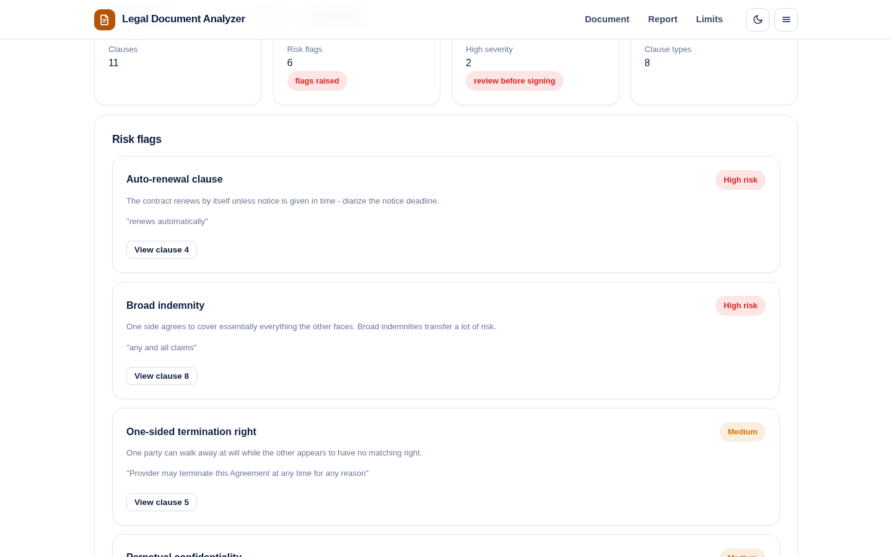
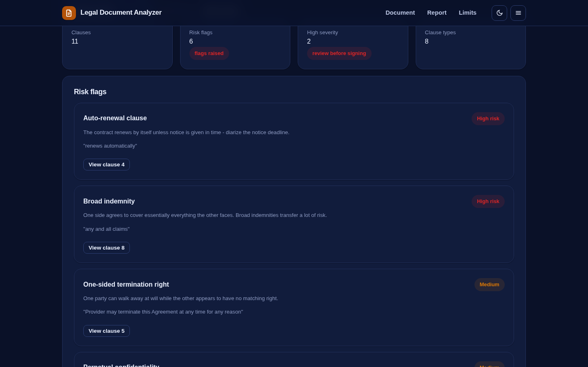
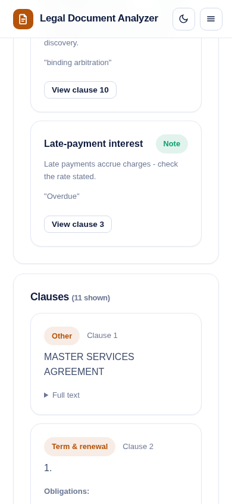

# Legal Document Analyzer

Read a contract the way a careful person would - before a lawyer ever sees it.

Paste any contract, NDA or terms of service and the analyzer splits it into clauses, classifies each clause by type (termination, liability, indemnity, payment, confidentiality, IP, governing law, renewal, warranties, non-compete), extracts obligations and time references, and raises risk flags with the exact sentence that triggered each one.

**Live demo:** https://akash991833.github.io/legal-doc-analyzer/



## What it catches

- **Auto-renewal** - the contract renews by itself unless notice is given in time
- **Broad indemnity** - "any and all claims" language that transfers a lot of risk to one side
- **No liability cap** - either no limitation-of-liability clause, or one with no cap language
- **One-sided termination** - one party can walk away at will, the other cannot
- **Perpetual confidentiality** - confidentiality that never expires
- **Long non-competes** - restrictions beyond the usual 12-month ceiling
- Binding arbitration, late-payment interest and more

Each flag explains what it means in plain English and links to the clause that caused it.

## Features

- Paste text or upload a .txt file; a realistic sample contract is included
- Clause browser with type filter and risks-only filter
- Obligation extraction ("shall", "must", "agrees to" sentences) per clause
- Export a markdown report of flags and clause summaries
- Dark and light themes, responsive, installable PWA that works offline
- Everything runs on-device - your contract text never leaves the browser

## Honest limits

- **Not legal advice.** This is a reading aid, not a lawyer.
- Rule-based pattern matching: it catches common clause shapes in English contracts, not every drafting style.
- It cannot judge whether a term is fair for your situation, only that a pattern exists.
- Plain text input only; convert scanned PDFs to text first.

## Python version (scikit-learn)

A pro-grade rebuild with TF-IDF clause classification over 12 legal clause types, entity extraction and a risk lexicon lives in [`python-app/`](python-app/) - see its README for run steps. The browser demo above stays the zero-install option.

## Tech

Vanilla JS, no build step, no dependencies, no network calls. Clause classification uses keyword scoring; risk detection uses curated pattern rules with severity levels.

## Run locally

```
python3 -m http.server 8060
# open http://localhost:8060
```

## Tests

```
python3 -m http.server 8060 &
node tests/run.mjs
```

56 checks across desktop and mobile, light and dark: clause splitting, every risk pattern on the sample contract, false-positive guard for liability caps, filters, obligations and console cleanliness.



